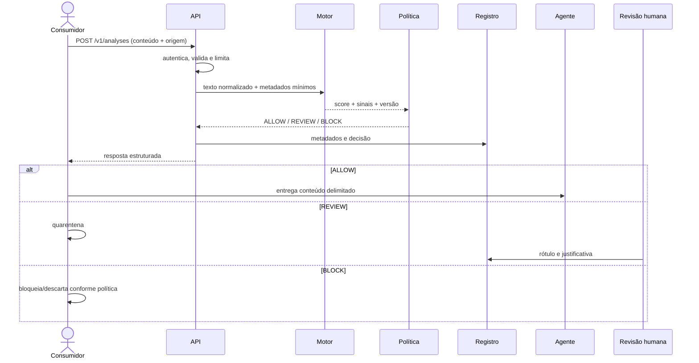

# Arquitetura proposta

## Princípios

- serviço independente e sem dependência do EvaGPT;
- LLM fora do caminho de classificação;
- falha segura configurável, rastreabilidade e menor privilégio;
- minimização de dados por padrão;
- contrato estável, motor e limiares versionados;
- execução do classificador e OCR em CPU no protótipo.

## Componentes

| Componente | Responsabilidade | Não deve fazer |
|---|---|---|
| Consumidor automatizado | Coletar conteúdo, extrair texto e aplicar a decisão | Enviar credenciais/metadados excessivos ou ignorar timeout |
| Adaptador visual | Validar arquivo, pré-processar e executar OCR | Interpretar semanticamente ou decidir risco |
| API pública | Autenticar, validar, limitar e orquestrar | Avaliar com LLM ou expor detalhes internos excessivos |
| Motor | Pré-processar, criar chunks, inferir, calibrar e agregar | Executar ferramenta externa |
| Política | Mapear score/risco para ALLOW/REVIEW/BLOCK | Alterar modelo ou rótulo silenciosamente |
| Registro | Guardar metadados, decisão, versão e auditoria | Reter conteúdo integral por padrão |
| API administrativa | Entregar métricas/histórico e receber revisão | Permitir acesso direto ao banco |
| Portal | Apresentar, filtrar e revisar | Tornar ataque armazenado executável/HTML ativo |
| Fila de retreino | Receber apenas rótulos aprovados | Promover feedback automaticamente |

## Sequência principal

## Agregação de conteúdo longo

O texto é segmentado respeitando blocos semânticos, com sobreposição. Cada chunk recebe score. Inicialmente, o documento herda o maior score, pois uma única instrução oculta pode comprometer o agente. A validação comparará `max`, média dos top-k e agregador treinado. O log guarda índices e scores, mas o portal mostra apenas trechos necessários e mascarados.

## Fluxo visual

1. lista permitida de tipos (`image/png`, `image/jpeg`, PDF) e tamanho/páginas;
2. antivírus/sandbox quando aplicável e remoção de metadados;
3. renderização segura do PDF, correção de rotação, escala, cinza e contraste;
4. múltiplas passagens de OCR quando a confiança for baixa;
5. texto e confiança enviados à API como `IMAGE_OCR` ou `PDF_OCR`;
6. baixa confiança pode elevar `ALLOW` para `REVIEW`, mas nunca reduzir risco;
7. imagem original é descartada após processamento, salvo base legal e política explícita.

Tesseract com pacote `por` é o ponto de partida por ser local, CPU-friendly e Apache 2.0. A avaliação comparará acurácia de transcrição e efeito na detecção, não apenas CER/WER isoladamente.

## Disponibilidade e segurança

- TLS, token de curta duração, rotação de segredo, escopos e rate limiting;
- limite de payload, profundidade JSON, páginas, pixels e tempo de OCR;
- idempotência para evitar registros duplicados;
- escape de todo conteúdo no portal para impedir XSS armazenado;
- logs técnicos sem corpo, token, URL assinada ou cabeçalho sensível;
- circuit breaker; em timeout, conteúdo externo vai para `REVIEW` por padrão;
- backup cifrado, teste de restauração, auditoria de acesso e segregação por ambiente.

## Decisões em aberto

| Decisão | Opções | Critério |
|---|---|---|
| Banco de metadados | PostgreSQL / solução gerenciada | Transação, auditoria, custo e operação acadêmica |
| Fila | Redis/RQ / RabbitMQ / serviço gerenciado | Volume de OCR e simplicidade |
| Servidor de inferência | FastAPI + ONNX Runtime / Transformers | p95, memória e portabilidade CPU |
| Identidade do portal | JWT próprio / OIDC | Segurança, prazo e disponibilidade do provedor |
| Retenção final | Conteúdo efêmero / amostragem governada | Base legal, finalidade e risco |

