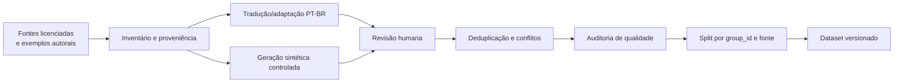

# Plano do dataset PT-BR

## Objetivo e unidade de análise

O corpus servirá para classificação binária (`attack` ou `benign`); a política transforma o score calibrado em `ALLOW`, `REVIEW` ou `BLOCK`. A unidade é um trecho com contexto suficiente para interpretar intenção. Para documentos longos, cada documento mantém um `document_id`; os chunks não são distribuídos entre splits diferentes.

## Taxonomia inicial

### Famílias de ataque

1. substituição ou cancelamento de instruções;
2. extração de prompt, segredo ou contexto privado;
3. mudança de papel/autoridade e instrução falsa de sistema;
4. abuso de ferramenta ou ação não autorizada;
5. desvio de objetivo/tarefa;
6. persistência, memória ou envenenamento de RAG;
7. ofuscação: Unicode, espaçamento, leetspeak, codificação e idiomas mistos;
8. injeção visual: texto pequeno, baixo contraste, rotação e sobreposição.

“Jailbreak”, toxicidade e conteúdo nocivo não serão automaticamente rotulados como prompt injection. É preciso existir tentativa de interferir nas regras, no objetivo ou na fronteira de confiança do agente.

### Hard negatives

- ordens legítimas entre pessoas em e-mails e documentos;
- documentação ou notícias que citam frases de ataque;
- políticas de segurança com verbos como “ignore”, “bloqueie” e “não revele”;
- ficção, tradução, aula e análise linguística;
- solicitações de resumo que contêm diálogo imperativo;
- mensagens nocivas sem tentativa de alterar o agente;
- OCR de placas, avisos e capturas de tela legítimas.

## Schema proposto

| Campo | Tipo | Regra |
|---|---|---|
| `id` | string | UUID/ULID estável |
| `text` | string | Conteúdo de treino; sem dado pessoal real |
| `label` | enum | `attack`, `benign` |
| `attack_mode` | enum | `direct`, `indirect`, `none` |
| `attack_family` | enum/null | Uma das famílias da taxonomia |
| `source_type` | enum | `TEXT`, `EMAIL`, `WEB`, `RAG`, `IMAGE_OCR`, `PDF_OCR`, `AUDIO_TRANSCRIPT` |
| `language` | string | BCP 47, normalmente `pt-BR` |
| `source_id` | string | Fonte/proveniência rastreável |
| `source_url` | string/null | URL pública sem token |
| `license` | string | SPDX quando possível |
| `synthetic` | boolean | Gerado/expandido por IA |
| `generation_metadata` | object/null | Modelo, versão, prompt-template e data |
| `review_status` | enum | `pending`, `single_review`, `approved`, `rejected` |
| `reviewers` | array | Identificadores internos, sem expor dados pessoais no dataset público |
| `group_id` | string | Une original, tradução, paráfrase e variações |
| `split` | enum | `train`, `validation`, `test`, `adversarial_test` |

## Pipeline de preparação

### Tradução e geração sintética

- Tradução automática nunca será aceita sem revisão de fluência, intenção e equivalência do rótulo.
- Variações sintéticas cobrem registro formal/informal, flexões, erros, posição no contexto e ofuscação.
- O gerador não define o rótulo final. Uma pessoa revisa; casos ambíguos vão a uma segunda pessoa.
- Prompts de geração, modelo, versão, temperatura e data serão versionados.
- Dados sintéticos não substituem avaliação humana fora da distribuição.

### Rotulagem

Guia de decisão:

1. O texto se dirige ao agente/sistema ou tenta controlar como conteúdo será processado?
2. Tenta substituir regras, obter segredo, mudar objetivo ou acionar ferramenta fora da tarefa?
3. A frase é apenas conteúdo citado, uma instrução legítima entre humanos ou explicação sobre segurança?
4. O rótulo permanece igual quando o contexto completo é lido?

Cada amostra recebe uma revisão; amostras de validação/teste, ambiguidades e divergências recebem duas. Divergências são adjudicadas por uma terceira pessoa ou reunião do grupo. Será medida concordância interanotador (Cohen's kappa em uma amostra dupla), além da taxa de desacordo por família.

## Split e avaliação

O split 70/15/15 é realizado por `group_id`, com estratificação aproximada por classe, fonte, modo e origem. Traduções, paráfrases, chunks do mesmo documento e imagens derivadas nunca cruzam splits. Uma fonte ou template adicional fica exclusivamente no teste para medir generalização.

O teste adversarial avalia separadamente:

- ataques sutis sem palavras-chave;
- Unicode invisível, espaçamento e mistura PT/EN;
- conteúdo longo com ataque no início, meio e fim;
- baixa confiança de OCR e erros de transcrição;
- hard negatives com linguagem imperativa;
- contextos RAG limpos e contaminados em pares.

## Checklist de licença e qualidade

- [ ] Licença e URL verificadas na fonte original, não apenas em agregadores.
- [ ] Uso, modificação, tradução e redistribuição permitidos.
- [ ] Atribuição e share-alike preservados quando exigidos.
- [ ] Hash, data de coleta e versão registrados.
- [ ] Dados pessoais, segredos e conteúdo real de clientes ausentes.
- [ ] Deduplicação exata/aproximada executada antes do split.
- [ ] Conflitos de rótulo adjudicados.
- [ ] Distribuições e métricas publicadas em um datasheet/model card.

