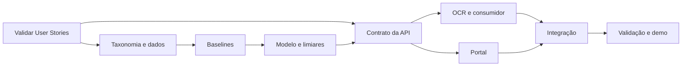

# Planejamento das próximas etapas

## Responsabilidades

Substituir os papéis pelos nomes e RMs. Uma pessoa pode acumular funções, mas toda entrega deve ter responsável e revisor diferentes.

| Frente | Responsável (R) | Aprovador (A) | Consultados (C) | Informados (I) |
|---|---|---|---|---|
| Produto, escopo e histórias | `PREENCHER` | `PREENCHER (PO)` | Grupo | Grupo |
| Dados, licença e rotulagem | `PREENCHER` | PO | ML, governança | Grupo |
| Baselines e modelo profundo | `PREENCHER` | Model Owner | Dados, MLOps | Grupo |
| API e persistência | `PREENCHER` | Tech Lead | Segurança, front-end | Grupo |
| OCR e consumidor automatizado | `PREENCHER` | Tech Lead | ML, back-end | Grupo |
| Portal e experiência | `PREENCHER` | PO | Analista, back-end | Grupo |
| Segurança e governança | `PREENCHER` | PO | Todas as frentes | Grupo |
| Documentação e vídeo | `PREENCHER` | PO | Grupo | Grupo |

## Kanban

**Link do Trello:** `PREENCHER`

Colunas: `Backlog → Refinado → Em andamento → Em revisão → Validado → Concluído`.

Políticas:

- um item só entra em andamento com história, critério de aceite, responsável, estimativa e dependências;
- limite de WIP: um item em andamento por integrante;
- revisão por outra pessoa é obrigatória;
- “Validado” exige evidência anexada; “Concluído” exige documentação atualizada;
- bloqueios recebem etiqueta, motivo e próxima ação; reunião curta duas vezes por semana.

## Backlog e marcos

### Sprint 1 — fundação

- validar IDs oficiais e prioridade das User Stories;
- preencher integrantes, RMs, Trello e vídeo;
- revisar proposta, arquitetura, contrato, wireframes e riscos;
- gravar vídeo humano, publicar não listado e testar links;
- criar repositório privado no padrão FIAP e conceder acesso aos avaliadores.

### Sprint 2 — dados e baselines

- aprovar taxonomia e guia de anotação;
- verificar licenças e registrar inventário;
- coletar/adaptar sementes e produzir hard negatives PT-BR;
- implementar split por grupo, deduplicação e testes de integridade;
- treinar B0, regras e TF-IDF; publicar avaliação reproduzível.

**Marco:** dataset v0.1 com datasheet + relatório dos baselines.

### Sprint 3 — motor profundo

- avaliar DeBERTa v2 sem adaptação;
- fine-tuning LoRA com busca controlada de hiperparâmetros;
- calibrar score e definir limiares somente na validação;
- congelar teste adversarial, medir segmentos e fazer análise de erros;
- exportar ONNX/INT8 e comparar qualidade, memória e p95 em CPU.

**Marco:** modelo candidato v0.1 + model card + critérios de promoção.

### Sprint 4 — serviço e fluxos

- implementar API conforme OpenAPI, autenticação, rate limit e idempotência;
- persistir metadados com retenção e auditoria;
- integrar OCR e avaliar casos visuais;
- construir consumidor automatizado e RAG simulado;
- executar testes de contrato, carga básica, falha segura e segurança.

**Marco:** fluxo ponta a ponta via API em ambiente de teste.

### Sprint 5 — portal e validação

- implementar login/RBAC, painel, histórico, detalhe e revisão;
- calcular métricas somente sobre amostras rotuladas e mostrar cobertura;
- proteger renderização, exportação e acesso ao conteúdo;
- integrar feedback governado à fila de retreino;
- realizar canary simulado, rollback e demonstração final.

**Marco:** protótipo funcional integrado com evidências de teste.

## Definition of Done

Um item está concluído quando:

- critérios de aceite foram demonstrados;
- testes proporcionais ao risco passaram;
- não contém segredo nem dado pessoal real;
- revisão por outro integrante foi registrada;
- documentação/diagrama/contrato foi atualizado;
- riscos e licenças afetados foram revisados;
- evidência (captura, relatório, execução ou link) está no cartão.

## Dependências e caminho crítico

Licença/proveniência e política de retenção são gates: dados não aprovados não entram no treino e conteúdo bruto não é persistido até a governança ser aceita.

