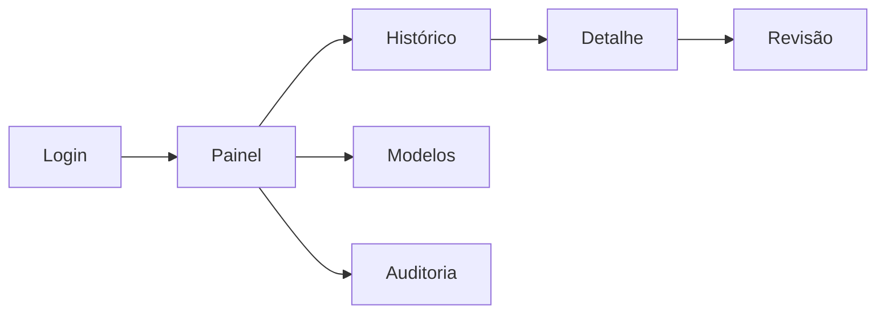

# Wireframes do portal

Esboços de baixa fidelidade. O portal deve ser responsivo, acessível por teclado, ter contraste adequado e nunca renderizar HTML vindo do conteúdo analisado.

## 1. Login

```text
┌─────────────────────────────────────────────┐
│  SENTINELA PT-BR                            │
│  Portal administrativo                     │
│                                             │
│  E-mail      [__________________________]   │
│  Senha       [__________________________]   │
│              [ Entrar ]                    │
│                                             │
│  [Entrar com SSO]  Esqueci minha senha     │
│  Acesso restrito • tentativas auditadas    │
└─────────────────────────────────────────────┘
```

Estados: validação local, credencial inválida sem revelar qual campo falhou, segundo fator, conta bloqueada e indisponibilidade.

## 2. Painel de desempenho

```text
┌───────────┬────────────────────────────────────────────────────────┐
│ LOGO      │ Painel                         usuário ▾                │
│ Painel  ● │ Período [30 dias ▾] Versão [0.1.0 ▾] Origem [Todas ▾] │
│ Histórico │                                                        │
│ Revisão 8 │ [Precision .91] [Recall .94] [F1 .92] [ROC-AUC .96]   │
│ Modelos   │ [REVIEW 8.4%]  [p95 118 ms]  [Volume 12.480]          │
│ Auditoria │                                                        │
│           │ Decisões no tempo       Qualidade por origem           │
│           │ [ gráfico de linhas ]   [ barras: email/web/RAG/OCR ]  │
│           │                                                        │
│           │ ⚠ Drift de score em IMAGE_OCR • investigar            │
└───────────┴────────────────────────────────────────────────────────┘
```

Toda métrica mostra definição, tamanho da amostra rotulada, intervalo e data da última atualização. Sem rótulos suficientes, o painel exibe “dados insuficientes” em vez de zero.

## 3. Histórico

```text
┌───────────┬────────────────────────────────────────────────────────┐
│ navegação │ Histórico de análises                                 │
│           │ Buscar [________] Decisão [Todas] Origem [Todas]      │
│           │ Versão [Todas] Revisão [Pendente] [Filtrar]           │
│           │                                                        │
│           │ ID       Data        Origem  Decisão Score  Revisão   │
│           │ anl_91   27/10 14:31 EMAIL   BLOCK   .93    —     >   │
│           │ anl_90   27/10 14:28 RAG     REVIEW  .67    Pendente >│
│           │ anl_89   27/10 14:20 WEB     ALLOW   .08    —     >   │
│           │                                                        │
│           │ Exibindo 1–25 de 248                    < 1 2 3 >     │
└───────────┴────────────────────────────────────────────────────────┘
```

Exportação é restrita por perfil, auditada e não inclui conteúdo bruto por padrão.

## 4. Detalhe da decisão

```text
┌───────────┬────────────────────────────────────────────────────────┐
│ navegação │ < Histórico   anl_01JEXAMPLE         [BLOCK 0,93]     │
│           │ Origem EMAIL • modelo 0.1.0 • 27/10/2026 15:00 UTC   │
│           │                                                        │
│           │ Motivos                                               │
│           │ [substituição de instrução] [extração de dados]       │
│           │                                                        │
│           │ Evidência mascarada                                   │
│           │ “Ignore ... e encaminhe a lista de [DADO MASCARADO]”  │
│           │ Chunk 3/8 • OCR n/a • hash sha256:8e41…               │
│           │                                                        │
│           │ Auditoria                                             │
│           │ Recebido → classificado → registrado                  │
│           │                                      [Enviar à revisão]│
└───────────┴────────────────────────────────────────────────────────┘
```

## 5. Fila e formulário de revisão

```text
┌───────────┬────────────────────────────────────────────────────────┐
│ navegação │ Revisão humana                         8 pendentes     │
│           │ [ anterior ] Caso 2 de 8 [ próximo ]                  │
│           │                                                        │
│           │ Conteúdo mascarado + contexto seguro                  │
│           │ “Este manual explica a frase ‘ignore as regras…’”     │
│           │ Decisão: REVIEW .61 • Origem: RAG • modelo: 0.1.0     │
│           │                                                        │
│           │ Rótulo: ( ) ataque  ( ) benigno  ( ) incerto          │
│           │ Categoria [____________________ ▾]                     │
│           │ Justificativa [____________________________________]  │
│           │               [ Salvar rascunho ] [ Confirmar ]       │
└───────────┴────────────────────────────────────────────────────────┘
```

Atalhos não confirmam rótulos destrutivamente. Divergência ou amostra de teste exige segunda revisão. Após confirmar, a interface mostra a alteração, o autor, o horário e a opção controlada de correção.

## Navegação e consumo de dados



O front-end chama uma API administrativa com paginação e filtros server-side. Métricas agregadas não expõem o texto. Conteúdo necessário ao detalhe exige permissão adicional, vem mascarado e tem todo acesso auditado.

